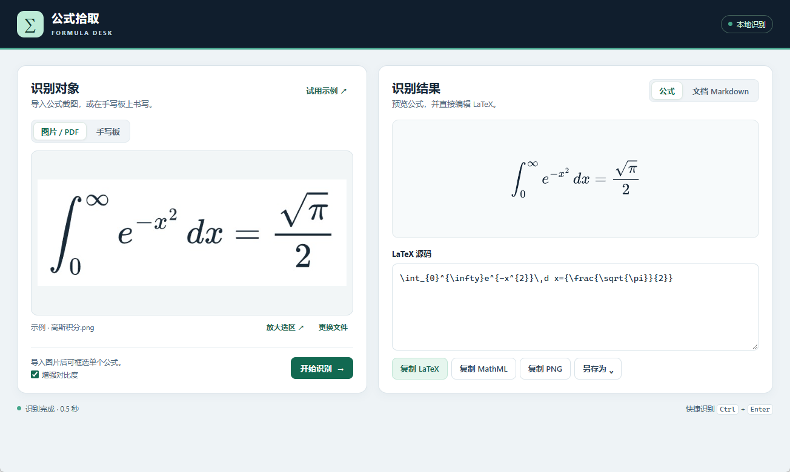

  <div align="center">
<p align="center">

<div/>
# FormulaDesk 公式拾取

FormulaDesk 是一个 Windows 桌面公式识别器。输入图片、截图、PDF 中的局部区域或手写内容，即可生成可编辑的 LaTeX。程序还支持逐页提取 PDF 文字，并将文本保存为 Markdown。依赖和模型准备好后，识别与渲染均在本机运行。

## 从源码运行

准备 **Windows 10/11 x64**、[Python 3.12 x64](https://www.python.org/downloads/windows/) 和 [Microsoft Edge WebView2 Runtime](https://developer.microsoft.com/microsoft-edge/webview2/)。

在 PowerShell 中进入项目文件夹，执行以下命令。已有 Python 3.12 且 `py` 命令不可用时，可用 `python -m venv .venv` 创建环境。

```powershell
Set-Location 'D:\Gadget_set\FormulaDesk'
py -3.12 -m venv .venv
.\.venv\Scripts\python.exe -m pip install -r requirements.txt
.\.venv\Scripts\python.exe setup_models.py
.\.venv\Scripts\python.exe app.py
```

首次准备公式模型需下载约 179 MB。脚本会校验每个文件的 SHA-256，并跳过已经校验通过的文件。手头已有同版本的模型时，可直接导入模型目录。

```powershell
.\.venv\Scripts\python.exe setup_models.py --from-dir 'C:\path\to\models'
```

在此前生成 FormulaDesk 的这台电脑上，可将示例路径换成 `C:\Users\Administrator\Documents\Codex\2026-11-19\ban\work\formula\models`，直接使用已校验的本地模型。

后续启动只需运行 `.\.venv\Scripts\python.exe app.py`。

## 使用方法

1. 在左侧选择文件、拖入图片或 PDF，或用 `Win + Shift + S` 截图后按 `Ctrl + V` 粘贴。图片支持 PNG、JPG、BMP、WebP 和 TIFF，单个文件最大 50 MB。
2. 在 **公式** 模式下，先框住单个公式，再点 **开始识别** 或按 `Ctrl + Enter`。PDF 可先翻到对应页，再用 **放大选区** 精细框选。手写输入可切换到 **手写板**。
3. 在右侧编辑 LaTeX，预览会随编辑更新。可以复制 LaTeX、MathML 或 PNG，也可以另存为 `.tex`、`.mml` 或 `.png`。
4. 需要提取正文时，切到 **文档 Markdown**，识别当前图片或 PDF 当前页。PDF 有可用文字层时优先提取文字，扫描页走文字 OCR。结果可编辑并另存为 `.md`。

第一次识别会加载模型。模糊或对比度较低的公式可以勾选 **增强对比度** 后重试。手写、复杂公式及文档排版需要对照原图校对。混排页面可在文档模式提取文字，再单独框选公式。

## 文件结构

```text
FormulaDesk/
├── app.py                Python 入口、识别和系统剪贴板
├── assets/               HTML、CSS、JavaScript、图标和 MathJax
├── setup_models.py       下载、导入及校验模型
├── requirements.txt      源码运行依赖
├── FormulaDesk.spec      原有 PyInstaller 打包配置
└── README.md
```

运行准备脚本后会生成 `models/`，包含三个 ONNX 模型和 `tokenizer.json`。公式模型来自 [RapidLaTeXOCR 官方发布页](https://github.com/RapidAI/RapidLaTeXOCR/releases/tag/v0.0.0)。界面使用本地 MathJax 渲染。第三方许可文本位于 `assets/vendor/`。

## 常见问题

- **窗口无法启动**。检查是否安装了 WebView2 Runtime，以及实际使用的 Python 是否为 3.12 x64。
- **提示缺少公式模型**。重新运行 `setup_models.py`。如果连接官方发布页超时，可手动从发布页下载模型，再用 `--from-dir` 导入其所在目录。
- **识别失败**。先试内置示例，再检查文件是否损坏、PDF 是否受密码保护，或选区是否只包含完整的单个公式。
- **查看运行日志**。在资源管理器地址栏打开 `%LOCALAPPDATA%\FormulaDesk`，查看 `app.log`。
